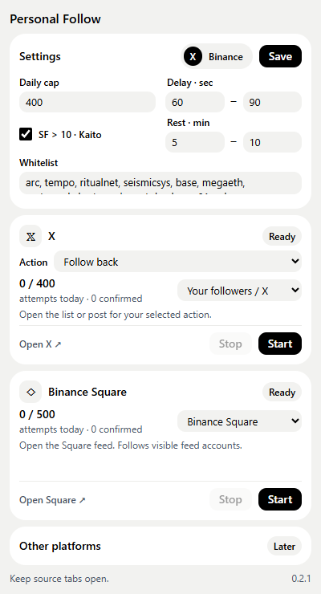

# Personal Follow

A Chrome extension that opens in Chrome’s native side panel beside your current page. Settings occupy the top third; platform functions occupy the bottom two thirds. Other platforms have a placeholder only.

## Install in Chrome

1. Download the extension ZIP supplied with this project and extract it to a permanent folder, or clone this repository.
2. Disable your old X Manager Tampermonkey scripts so both tools do not act at once. Keep the Kaito badge extension enabled if using the Personal filter.
3. Open `chrome://extensions`, turn on Developer mode, and choose **Load unpacked**.
4. Select the folder containing `manifest.json` (the `extension` folder if using this repository).
5. Allow the added Chrome debugger permission if prompted, then refresh open X and Binance tabs after installing or reloading the extension.
6. Click the Personal Follow extension icon to open Chrome’s side panel (Chrome 114 or later). Open the required platform tab, choose it in the platform row, save settings, and click Start. Stop cancels pending waits; an already submitted action cannot be undone.

## X

Adapted from [your X Manager](https://github.com/KattyFury/tool_personal_xmanager), with both source userscripts copied unchanged under `reference/xmanager/`.

- **Follow back:** open your followers or verified followers list.
- **Mass follow:** open a post with replies; targets verified reply authors.
- **Unfollow:** open your following list; choose top to bottom or bottom to top.
- Personal filter enabled by default: follow only SF > 10; unfollow SF ≤ 10; skip missing SF and preserve the whitelist. Requires your Kaito badge extension.
- Personal filter off: no SF requirement for follows; unfollow preserves the whitelist and verified accounts that follow you.
- Original defaults retained: 400 attempts/day, 60–90 seconds between actions, 5–10 minute rests after 20–30 mass-follow/unfollow actions. Full source whitelist retained.

## Binance Square

Open the Square feed and keep this tab active. Close DevTools on it before starting. The runner uses browser-level mouse input through Chrome debugger to hover a visible author name, waits for that author’s profile card, clicks Follow inside that card, waits the configured delay, then scrolls to the next accounts. Already-followed accounts are skipped. A missing hover card is retried three times (including the avatar/name wrapper), then that account is skipped without reserving a Follow attempt. Three consecutive accounts with missing cards stop the runner so it cannot scroll indefinitely. Page changes or unclear action outcomes still stop immediately.

Defaults: **500 attempts/day**, random **10–30 seconds** between follows. The cap is your configured maximum, not an official Binance limit. Current live feed markup still needs validation; the adapter may find no eligible buttons if Binance changes its layout.

## How counts and settings work

Settings and counters are saved in Chrome extension storage. A background worker serializes reservations, permitting one run per platform across tabs. The cap counts **attempts**, reserved before clicking; confirmed outcomes have a separate count. Failed or uncertain attempts remain counted. Counters reset at midnight in Vietnam time. X and Binance have independent caps. A browser restart stops runners while retaining settings and daily counters. Saving settings applies to the next start.

The extension does not transfer legacy userscript counters/settings automatically. Avoid using the legacy and new tools on the same day without adjusting the remaining cap. Chrome may delay background-tab timers; the specified delay is a minimum range rather than an exact execution guarantee. Keep source tabs open and check them if the sidebar requests attention. Login/verification/restriction checks cover known visible prompts; they are not an exhaustive platform detector.

## Design and validation

The sidebar copies [your design tokens](https://github.com/KattyFury/repo_personal_design) and follows Bento v4. The sidebar uses a vertical 1:2 split: settings above, platform functions below. See [source provenance](docs/SOURCES.md) and [test details](docs/TESTING.md).

`npm ci`

`npm test`

`npm run check`

`npx playwright test` (requires Google Chrome)

The extension runs directly from `extension/`; no build or runtime dependencies are needed. Development dependencies are used only for tests.

**Validation status:** automated tests use simulated DOM and mocked extension messages. No live follows or unfollows have been performed, and the extension has not been installed into your Chrome. Start with a small cap for live validation.

## Browser hover in 0.3.0

Binance hover no longer uses JavaScript-dispatched mouse events. It uses `Input.dispatchMouseEvent` through the required `debugger` permission, explicitly authorized by the user. Chrome shows its debugging notification while attached. The implementation only permits mouse movement for the active, selected Binance Square run, rejects other tabs, stale tokens, subframes, and invalid coordinates, and detaches on Stop, normal/error completion, navigation, or refreshed content. Dismissing the debugger notification stops the run. It does not move the Windows hardware cursor. X behavior is unchanged.

Status distinguishes requesting pointer movement, successful Chrome input, and detected profile card. `node scripts/check-browser-hover.js` proves the difference between a dispatched JS event and actual CSS hover. `node scripts/check-binance-hover.js` verifies the complete content-runner-to-browser-input path against a local CSS-hover-only fixture, including one confirmed fixture follow and the daily cap. Neither script accesses a live account.
